# 구조 평가와 구현 결정

검토일: 2026-10-12. 범위는 참고 글의 분석과 이 저장소의 harness 구현이다.
외부 대상에 대한 실제 보안감사는 이번 작업에 포함하지 않는다.

## 참고 글에서 확인한 구조

[Quarkslab 원문](https://blog.quarkslab.com/from-ai-agents-to-rce-building-a-vulnerability-research-workflow.html)은
재현 가능한 분석 코어와 비결정적인 agent 판단을 분리한다.
코어는 코드 관계와 taint·패턴 분석을 제공하고, agent는 가설을 조사하고 결과를 정리한다.
연구자는 단계 사이에서 방향과 증거를 확인한다.

원문의 단계는 `graph → recon → slicing → analysis → triage → poc → chain → exploit`이다.
전체 저장소를 한 번에 읽히기보다 좁은 범위를 조사하고, 관련 후보를 모은 뒤 동적으로 검증한다.
FreeRDP 사례에서 글에 다룬 두 slice의 후보 130개가 36개 cluster로 줄었고,
그중 20개가 재현되었다고 보고한다. 전체 보고까지는 4일이 걸렸다고 한다.
이 수치는 두 slice의 사례이며 전체 저장소의 정확도·재현율을 나타내지 않는다.
유효한 발견의 순위가 낮았고 최종 exploit 구성에는 연구자 개입이 필요했다고 명시한다.

## 효율적인 구조인가

**작업을 검토 가능한 단위로 나누는 구조는 타당하다. 성능 우위는 아직 검증되지 않았다.**
이는 원문의 설계를 검토한 판단이다. 공개 글은 내부 구현과 통제된 비교 실험을 제공하지 않으므로,
같은 모델을 사용한 단일 agent와의 비용·시간·품질 차이는 직접 측정해야 한다.

| 설계 요소 | 채택 이유 | 이 프로젝트에서 확인할 비용 또는 실패 가능성 |
| --- | --- | --- |
| 결정적인 코어와 agent 분리 | 증거 생산과 가설 판단의 책임을 명확히 함 | 코어의 잘못된 관계가 모든 후속 판단에 전파될 수 있음 |
| 좁은 slice | 입력 크기를 제한하고 개별 실험을 비교할 수 있음 | 호출자·객체 수명·다른 파일의 조건이 누락될 수 있음 |
| 넓게 찾고 triage로 줄임 | 연구자가 읽을 후보 수를 관리할 수 있음 | agent 비용이 오탐 수에 비례하므로 초기에 중복 제거 필요 |
| 별도 triage 세션 | 이전 대화에서 생긴 확신을 줄일 여지가 있음 | 같은 모델과 증거의 공통 오류는 독립 세션으로 해결되지 않음 |
| 동적 검증 | 관찰 가능한 결과를 확보함 | 직접 호출한 함수의 crash만으로 실제 노출 경로를 증명할 수 없음 |
| 단계별 기록과 연구자 점검 | 실패 지점과 판단 근거를 되짚기 쉬움 | 점검 빈도가 높으면 사람이 다시 병목이 됨 |

구현 순서는 **호출 구조 → 노출 정보 → 관계 기반 slice → 분석·triage**다.
처음 작성한 orchestration과 줄 slice는 이 핵심을 충족하지 못한 실행 골격이다.
현재는 Clang AST·Go 타입 정보·Solidity solc AST·Python 표준 AST로 호출 그래프를 추출하고
공통 계약으로 초기 조사 단계에 제공한다.
Go에서는 선언 문맥·등록 사실을 더하고 연구자의 가설을 다중 파일 agent 입력으로 연결한다.
정규식이나 모델의 추측으로 호출 간선을 만들지 않는다.

## 현재 구현

```mermaid
flowchart LR
    A[C/C++ 소스와 파싱 설정] --> B[Clang 추출기]
    H[Go 모듈 snapshot] --> I[go/packages 타입 추출기]
    S[Solidity 소스 내용] --> T[solc-js typed AST 추출기]
    P[Python 소스 snapshot] --> U[격리된 Python AST 추출기]
    U --> C
    T --> C
    B --> C[공통 그래프 계약 v2]
    I --> C
    C --> D[파일과 패키지 간 호출 요약]
    C --> E[resolve와 reachable 조회]
    E --> F[원문에 연결한 가설과 recon]
    J[연구자가 제공한 조사 계획] --> F
    C --> RP[등록·Solidity visibility·정적 역할·원문을 byte 예산으로 공급]
    X --> RP
    RP --> RR[agent의 조사 계획·우선순위 제안]
    RR --> RC[함수 ID·인용 검증과 미해결/누락 보존]
    RC --> F
    F --> K[byte 예산의 다중 파일 slice]
    P --> V[고정 Semgrep CE와 로컬 모델]
    H --> V
    C --> W[graph/source identity와 근거 검증]
    V --> W
    W --> X[별도 static.json 역할·taint·분석 경계]
    X --> K
    K --> G[analysis 후보]
    G --> QL[resolve/reachable/원문 조회 요청]
    C --> QQ[검증된 snapshot과 조회 예산]
    QL --> QQ
    QQ --> QR[원문·호출·미해결 응답과 checkpoint]
    QR --> G
    QR --> Y
    G --> MP[source·sink 함수와 원문 근거 제안]
    MP --> MC[확정 호출 표기로 제한된 모델 생성]
    MC --> MS[같은 고정 CE로 두 번째 분석]
    MS --> MF[첫 근거 보존·binding/gap 확인·byte 예산]
    MF --> G
    MF --> Y
    G --> Y[triage 원인·수정 가설과 후보별 판정]
    Y --> Z[원문 검증 후 동일 원인·수정 위치 병합]
    Z --> Q[clusters와 전체 findings·반증·미해결 근거]
    Q --> R[기각 제외 validation 대기열]
    EX[외부 source-backed 후보] --> EI[import 원문·triage·gap 검사]
    EI --> Q
    R --> PP[bounded PoC 코드·oracle·설정·미해결 제안]
    PP --> PR[별도 연구자 승인·기각·수정 요청 기록]
    PR --> PB[승인한 제안·후보·review·source·recipe hash 결합]
    R --> AA[후보 ID와 source hash 검증]
    PB --> AA
    PB --> MX[최대 4개 설정과 동일 oracle·수정 입력 고정]
    MX --> MV[case별 최대 8회 worker 예산·실패/누락 보존]
    MV --> AA
    AB[대상 밖의 명시적 recipe와 준비된 이미지 ID] --> AA
    AA --> AC[격리 정책 확인과 독립 폐기 타이머]
    AC --> AD[Docker 안에서만 명령 실행]
    AD --> AE[상태·실패·bounded 로그와 증거 hash]
    AE --> AF[고정 oracle의 재현·진입점 관찰 확인]
    AG[동일 조건의 수정 후 worker 기록] --> AH[수정 전후 비교]
    AF --> AH
    AE --> MO[실제 설정 관찰과 source/invocation proof]
    MO --> AH
    AH --> AI[기존 반증·미해결 issue와 해소 근거 확인]
    AI --> AJ[별도 judgment와 validated 승격 기준]
    AJ --> CP[검증된 두 primitive의 원본·source·image·설정 재확인]
    CP --> CH[prepare-chain: 순서·상태 전달 가설·전제·반증 보존]
    CH --> CE[별도 chain 검토·승인 PoC·고정 worker]
    CE --> CJ[전달 byte·잘못된 상태 대조군·진입 순서 판정]
    CJ --> IR[impact-review: 속성·위협 문맥·대조군·단계 승인]
    AJ --> IR
    IR --> IW[setup·primitive·control·impact별 격리 worker]
    IW --> IG[impact-step: 원본·관찰·연구자 approve/retry/reject]
    IG --> IW
    IG --> IO[전체 순서·대조군·열린 근거 확인 후 impact_observed]
```

현재 graph와 Python/Go 정적 분석 근거 연동, 대상 함수 모델을 이용한 두 번째 분석은 실행 가능하다.
원문의 함수 포인터 해석·
함수 간 taint 및 전체 8단계를 복제한 완성품은 아니다.
`run --graph ... --recon ...`은 위 입력을 소비한다. 옵션 없는 실행은 기존 줄 입력을 유지한다.
recon은 원문 인용·함수 식별·등록 사실을 검증한다. 지원한 근거로 agent가 계획을 제안할 수 있지만
전체 저장소의 자동 threat model 또는 taint 분석은 아니다.
제안 입력에는 공급된 함수의 graph 호출 상태와 대상 ID도 byte 예산 안에서 포함한다.
빠진 호출은 coverage에 남기며, 호출 사실은 실행 경로나 taint의 증명이 아니다.

| 원문 단계 | 현재 상태 | 다음 확장 위치 |
| --- | --- | --- |
| graph | 공통 계약, Clang/Go/Solidity/Python 호출·도달 조회; 선언·import와 Solidity modifier 근거 | 미해결 관계·런타임 binding 해석 |
| recon | 연구자 계획과 Go 등록/Solidity visibility/정적 역할 기반 agent 계획; 원문·함수 ID·우선순위 이유·누락/미해결 보존 | 타 등록 adapter·생성된 getter·배포/프록시 근거·실제 계획 품질/우선순위 평가 |
| slicing | 한 가설의 다중 파일 함수·선언·호출 근거와 누락 기록; 기존 줄 입력 유지 | 실제 benchmark와 데이터 흐름 근거 기반 확장 |
| analysis | Codex 또는 replay, 고정 JSON; 제한된 graph/원문 조사; source 기반 함수 모델과 실제 CE의 두 번째 함수 내부 taint 분석 | 인자별 역할·sanitizer 모델, 타 언어·함수 간 흐름, 운영 대상 평가 |
| triage | 원문에 연결한 원인·수정 가설별 cluster; 후보별 반증·보류·입력 gap 보존 | 운영 대상의 의미 정확도·사람 검토·동적 증거 보강 |
| poc | 외부 후보 진입·bounded 코드/oracle 제안·별도 검토; 격리 worker·설정별 전후 비교·근거별 승격 | compiler별 자동 계측·실제 배포/영향 검증 |
| chain | 검증된 두 판정과 원본 worker/source/configuration 재확인; source 기반 가설·별도 연구자 검토·고정 PoC/worker 관찰·연결 판정; 두 결함 합성 예제의 실제 격리 연결·잘못된 상태 대조군 | 운영 대상의 인과관계와 계측/검증 코드 품질 평가 |
| exploit | I1의 source·PoC·연구자 승인 계획과 단계별 worker/checkpoint·대조군·속성 관찰 gate; 두 결함 합성 예제의 실제 격리 단계별 영향 측정 | 운영 대상의 측정 품질과 영향 검토; 운영 공격을 자동 실행하는 단계가 아님 |

현재 코드의 완료 근거 재검수(2026-10-13): 저장된 두 primitive/chain/impact의 원본
worker 9개를 다시 읽고 chain 판정과 네 단계 checkpoint를 기존 검증기로 재계산했다.
`connected`와 별도의 `impact_observed`가 원래 기록과 같았으며 전부 cleanup removed였다.
이후 새 compiler matrix 실험에서 네 격리 worker가 실제 C를 컴파일·실행했다.
release의 전후 재현/차단과 guarded의 초기 차단을 각각 보존했고 admin 대조군은 유지됐다.
두 case의 관찰 coverage는 complete이며 validated case는 release 하나다.
이는 고정된 합성 입력의 실행 근거다. 이후 M5에서 언어별 두 완료 pair를 확보했으며,
품질·비용 결과는 혼합되어 일반적인 우위를 입증하지 않았다.

## Python 추출 경계

Python 추출기는 표준 `ast`로 source snapshot을 파싱하며 대상 모듈을 import하지 않는다.
패키지 부모/import root인 대상의 `.`과 `src/`를 모듈 이름으로 매핑한다.
같은 모듈 이름의 경로 충돌과 순환 재수출은 확정 간선으로 바꾸지 않는다.
모듈·lexical scope의 선언과 import 별칭/상대 import/재수출을 정적으로 연결한다.
함수 값을 넘기는 callback·값 alias·객체 메서드와 조건부/재대입/decorator/wildcard
binding은 미해결로 남긴다.
확정된 직접 호출에는 정확한 위치·원문과 인자→매개변수 대응을 선택적 metadata로 기록한다.
단순 직선형 함수의 상수·매개변수·직접 호출 반환값만 `argument_origins`로 추적한다.
분기·반복·재대입·비동기 함수는 출처를 unknown으로 두며, 키워드·기본값·가변 인자나
인자 수가 맞지 않는 호출은 `argument_transfer_gap`을 남긴다. 이 구문 근거와
선언된 Python 정적 source/sink 역할이 정확히 맞을 때만 recon에 제한된
`bounded_syntax_value_path`를 붙인다. 실행·오염 전파·취약성의 증거는 아니다.
직접 attribute 쓰기와 global/nonlocal 변경도 확정 연결을 제한한다.
표준 AST 위치의 UTF-8 byte column을 공통 계약에 대응하며 import·전역 값·class header는
기존 `contexts`에 보존한다. 재수출의 중간 선언은 context 참조로 slice에 포함하며 실행 간선과 구분한다.

`python -I`의 별도 프로세스에 소스 JSON만 전달한다. 대상·setup/config·PYTHONPATH를 실행하거나
의존성을 내려받지 않는다. 기존 timeout/output cap 및 256개 파일·파일당 100,000 AST node 상한을 사용한다.
문법 오류 파일은 coverage에 남기고 그 파일의 함수로 연결하지 않는다.
설정은 검증하지 않았으므로 `configuration_verified=false`; `parsed`는 문법 파싱 상태다.
module/class 초기화·정의 시점 호출·lambda 본문, 동적 import·상속/descriptor·실행 중 binding은 후속 범위다.
async/generator 호출은 문법상의 의존성이며 함수 본문 실행이나 공격자 도달성을 입증하지 않는다.

## 데이터와 상태

`graph.py`는 언어와 무관한 schema 검증·저장·요약·조회만 담당하고 `extractors/`가 언어별 추출을 맡는다.
`schemas/graph.json`이 공통 계약 v2다. 함수는 ID·언어·scope·종류·이름·시그니처·정의 위치,
호출은 caller/callee·호출 위치·status·dispatch·execution·reason·provenance를 갖는다.
컴파일러 고유 심볼·TU 목록은 metadata에 둔다. 파일/패키지 요약은 공통 코어가 확정된 호출로 계산한다.
새 결과는 v2를 쓰고 기존 v1 파일은 reader와 resolve/reachable에서 계속 읽는다.

C/C++ 함수의 경우:
함수 ID는 compiler 심볼과 정의 위치로 생성하며 `static`·anonymous namespace는 TU 범위를 포함한다.
같은 이름을 가진 파일 내부 함수와 C++ overload를 이름만으로 합치지 않는다.
같은 external 심볼에 서로 다른 정의가 있으면 `ambiguous`로 남긴다.
헤더의 동일 external inline 정의는 하나로 모으고 이를 파싱한 TU 목록을 보존한다.
공통 호출 상태는 `resolved`, `external`, `ambiguous`, `unresolved`다.
`dispatch`가 `indirect`, `virtual`, `constructor` 등의 해석 방식을 구분한다.
`resolved`에만 그래프 간선을 연결한다. `sizeof`와 `noexcept` 등 unevaluated 표현은 호출에서 제외한다.
암묵적인 호출과 모든 C++ 생명주기 동작을 포괄하는 그래프는 아니다.

`resolve`는 파일/함수/패키지의 정의·들어오는 호출·나가는 호출을 보여준다.
`reachable`은 직접 호출 간선으로만 탐색하며 도중의 미해결 호출도 반환한다.
이는 syntax상 호출 가능 범위이지 runtime 조건·공격자 노출·taint를 증명하는 결과가 아니다.

파싱은 [Clang AST](https://clang.llvm.org/docs/IntroductionToTheClangAST.html)를 사용하며,
설정 입력은 [Compilation Database](https://clang.llvm.org/docs/JSONCompilationDatabase.html) 형식을 지원한다.
DB의 프로그램을 실행하지 않고 `-I/-isystem/-iquote`, `-D/-U`, `-x`, `-std`만 전달한다.
버린 flag·DB에 없는 TU·parse 실패·미지원 언어·미방문 헤더를 coverage에 보존한다.
DB가 없으면 toolchain 기본 설정임을 표시하며, ignored flag가 있으면 coverage는 partial이다.
실패한 TU의 AST는 전부 제외한다. AST/로그는 각각 64 MiB, TU는 256개, 기본 timeout은 TU당 30초다.
대상 소스 변경을 전후 hash로 확인하고, 그래프 조회에서는 checksum과 간선 endpoint를 검사한다.
조회는 소스를 다시 열거나 실행하지 않는다. 입력 설정과 toolchain이 같으면 동일 JSON을 생성한다.

Go 추출기는 [go/packages](https://pkg.go.dev/golang.org/x/tools/go/packages)와
[go/types](https://pkg.go.dev/go/types)를 사용한다. 패키지 경로·receiver·generic 원형·정의 위치로
함수를 식별하고, import 별칭·다른 파일·패키지의 정적 함수와 구체 메서드를 연결한다.
인터페이스 호출과 함수 변수는 `callee=null`과 원인을 보존한다. points-to 분석을 추측으로 대체하지 않는다.
literal의 본문 호출은 별도 함수에 귀속하고 `go`/`defer` 실행 방식을 기록한다.
Go의 scope는 패키지 경로이며 `scope_calls`가 패키지 간 관계를 요약한다.

Go의 선택적 `contexts`는 타입/필드 선언, 전역 값 선언, 파일의 package/import 문맥을 담는다.
`context_ids`와 context의 `references`는 원문 의존성을 나타내며 호출 간선과 분리한다.
`resolve`/`reachable`는 참조 context의 위치도 반환하지만 소스를 다시 읽지는 않는다.
`function_arguments`는 인자로 전달된 직접 함수/literal ID 또는 미해결 원인을 보존한다.
v2의 선택적 확장이므로 이전 v2와 v1 조회는 유지한다. Clang에는 아직 선언 context 추출이 없다.
Go의 확정된 직접 호출은 `metadata.argument_transfers`에 인자 원문·UTF-8 byte 위치·source hash와
대응하는 매개변수 이름·타입을 둔다. 상수 인자와 식별자를 구분한다. 메서드·generic·variadic·
인자 수 불일치·256 byte 초과는 `argument_transfer_gap`으로 남기며, interface/function value에는
전달 관계를 만들지 않는다. 이 한 호출의 구문 사실은 함수 간 taint나 실행 증명이 아니다.
Go 호출의 `metadata.argument_origins`는 단순 상수·매개변수·직접 호출 반환값을 구분한다.
동일 함수의 앞선 단순 대입만 좇고 분기·반복·재대입·주소 이탈·closure·가변 타입·
변환·간접 호출은 unknown으로 둔다.
호출의 시작/끝 byte 위치로 정적 역할의 정확한 호출 표현식만 맞춘다. recon의
`value_flows`는 동일 규칙의 선언된 source→sink 역할 사이에서 이 사실과 확정된
인자→매개변수 대응을 제한된 길이로 연결한다. `bounded_syntax_value_path`는 구문상
값 전달 근거이며 실행 가능성, 공격자 제어, sanitizer 효과 또는 취약성 판정이 아니다.
미연결 역할 쌍과 예산 누락은 recon coverage에 남긴다.
Python도 같은 선택적 graph v2 metadata와 recon 경로 계약을 사용하되,
표준 AST의 단순 직선형 문장과 직접 위치가 확인된 호출만 출처로 사용한다.

필터링된 소스와 go.mod/go.sum만 임시 복사해 분석하고 설정 hash를 재확인한다.
하나의 모듈과 호스트 기본 build 조건을 지원하며 workspace·중첩 모듈·로컬 replace는 거절한다.
사용자 환경의 driver/GOFLAGS를 제거하고 cgo·workspace·자동 toolchain 전환·다운로드를 차단한다.
타입 로딩에 필요한 export data는 컴파일할 수 있지만 대상 프로그램·init·test·generator는 실행하지 않는다.
외부 의존성은 전용 캐시에 사전 준비해야 한다. 실패 패키지의 부분 타입 정보로 관계를 생성하지 않는다.
package-global initializer와 reflection은 아직 모델링하지 않으며 이 제한을 graph에 기록한다.
기본 timeout은 helper build/analysis 각각 30초, 도구 출력/로그는 각각 64 MiB, 패키지는 256개까지다.

Solidity는 [Standard JSON](https://docs.soliditylang.org/en/v0.8.30/using-the-compiler.html)의
타입 검사가 끝난 AST를 사용한다. 소스 위치는 [byte source mapping](https://docs.soliditylang.org/en/v0.8.30/internals/source_mappings.html)을
실제 입력의 줄·byte column에 대응시킨다. 공통 v2 schema를 변경하지 않고 `contexts`와 metadata를 활용한다.
상속 header는 base context를 참조하며, 함수 metadata는 직접 base·C3 선형화·override ID를 보존한다.
비가상 내부/상속/library 함수와 modifier 적용만 resolved dependency로 연결한다.
modifier는 별도 함수 노드이며 적용 순서·placeholder 수와 본문 호출을 보존한다.
기존 호출 간선은 구조적 의존성이며 `metadata.modifier_flow`가 modifier 제어 흐름을 별도로 보존한다.
flow의 로컬 노드는 소스 byte 위치와 원래 함수·호출 ID를 참조한다. 조건의 true/false 간선,
`_`의 invoke/resume, wrapper의 enter/exit와 return/revert, loop의 break/continue를 구분한다.
첫 modifier가 바깥쪽이다. 각 `_`에 다음 modifier를 중첩하고 마지막 continuation에 함수 본문을
원자적 body 노드로 둔다. 안쪽 modifier의 return은 바깥쪽 `_` 뒤로 복귀하며 함수 본문의 return도
정상 복귀 후처리를 생략하지 않는다. 인자는 해당 wrapper에 재진입할 때 다시 평가하는 것으로 표시한다.

`body_execution`은 정상 exit에 도달하는 구문상 경로의 body/continuation 개수를 센다.
조건은 symbolic이며 bool literal 외 상수·인자 치환·경로 만족 여부는 풀지 않는다.
본문 생략(min=0), 반복(min/max), 정상 exit 경로 없음과 양의 body-count cycle(unbounded)을 구분한다.
modifier 단독 flow에서는 실행 단위가 continuation이며 적용 함수에서는 function_body다.
호출과 본문 내부의 데이터 흐름·예외 효과·권한 의미는 이 모델의 범위 밖이다.

virtual modifier와 assembly/try, expression 내부의 단락/삼항 분기는 gap이며 실행 횟수를 unknown으로 둔다.
확장은 함수당 384노드/깊이 64, 누적 확장 8,192노드로 제한한다. 상한 초과는 부분 CFG 대신
명시적인 opaque flow로 대체한다. 추가 함수는 작은 gap flow만 갖는다.
공통 graph v2 schema는 그대로다. 선택적 extension의 endpoint·소스 범위·호출/적용 순서와
실행 횟수 요약을 graph reader가 검증하며 기존 v2/v1과 Clang/Go artifact는 그대로 조회한다.
recon slice는 원문 함수가 모두 포함되고 byte 제한에 맞는 flow만 제공한다. 빠진 flow는
coverage와 omitted counts에 남으며 agent prompt는 이름·간선·실행 횟수만으로 통제 효과를 판단하지 않도록 한다.
외부 계약·interface·self-call·외부 library는 declaration ID를 남기되 `callee=null`로 처리한다.
virtual/super·함수 값·저수준 호출은 미해결이고 assembly는 opaque boundary다.
확정된 직접 내부 호출에 한해 인자의 정확한 원문·byte 위치·대상 매개변수를
`argument_transfers`에 기록하고, 호출자 매개변수 식별자와 literal만
`argument_origins`로 분류한다. named/arity 불일치와 긴 표현식은 gap으로 남긴다.
이 첫 단계에는 Solidity 정적 source/sink adapter가 없어 recon의 함수 간
`value_flows`를 만들지 않는다. 외부·virtual·super 관계를 내부 전달로 바꾸지 않는다.

compiler는 pinned solc-js 0.8.30이며 npm 준비 단계만 다운로드한다. 실행 단계는 snapshot의
소스 내용만 넘기고 import callback의 filesystem/network fallback을 차단한다.
Node preload 환경변수와 대상 Foundry/Hardhat script를 사용하지 않는다. AST만 요청하며 EVM 코드는 실행하지 않는다.
256개 소스와 과정당 30초/출력 64 MiB 상한을 적용한다. compiler 오류가 있으면 batch의 모든 부분 AST를 제외한다.
프로젝트 remapping/build 설정, initializer 실행과 암묵적 base constructor는 아직 해석하지 않는다.

아래 계약은 별도로 구현된 기존 agent 실행 골격에 해당한다.

파일 내용 hash와 정렬된 경로가 source index를 식별한다.
기존 slice는 하나의 파일, 실제 시작·끝 줄, 원문, source hash를 가진다.
관계 기반 slice는 한 가설과 다중 파일 `fragments`, 실제 정의·호출 근거·조사 주석,
누락 수를 가진다. 각 fragment의 원문·줄·hash를 검증한다.
`recon.json`은 strict 연구 계획과 graph/source에서 재계산해 검증한다.
보안 주석은 연구자 또는 agent가 제공한 가설이며, 자동 노출/위협 모델 분석이 아니다.
Go 표준 HTTP의 직접 함수 등록은 별도 근거다. 등록·호출·외부 노출은 구분한다.
`recon --replay/--codex`는 지원한 등록과 정적 역할·전체 함수 원문을 기본 16,000 byte 안에서
공급한다. 제안은 해당 entry의 registration/source fact, 제공한 함수 ID·byte 인용, 우선순위 이유와
미해결 사항을 요구한다. 엄격한 schema는 노출 확인 필드를 받지 않는다. 원문을 검증해도 역할·
우선순위 의미는 가설로 남고 core가 미확인 노출과 입력 누락·미선택 진입점을 별도 gap으로 남긴다.
`context.json`의 `relationships`는 공급한 진입 사실에서 정적 source/sink/sanitizer 역할까지
확정된 직접 호출 ID의 최단 경로 하나만 보여준다. 같은 함수의 두 사실은 빈 경로다.
경로 부재·중간 함수 미공급·byte/256쌍 예산 초과는 `coverage.json`의 omission/gap이다.
Go HTTP query 추출과 `os.ReadFile`은 선언된 `CWE-73` 역할 규칙으로 관찰하지만,
두 파일의 역할과 호출 경로만으로 요청값 전달·허용 경로·실제 HTTP 노출은 확정하지 않는다.
`research-plan.json`의 선택적 selection/proposal_origin은 기존 수동 계획과 호환되며
recon/slice/triage/judgment에 원본 참조와 `recon_gap_ids`로 보존된다. static을 사용한 계획은
같은 static artifact가 필요하다. 제안은 독립된 한 호출이며 실패·timeout·재개는 시도별로 기록한다.
`run`은 원래 byte 한도와 graph/static/source에서 제공된 context를 재계산하고 fact/entry 대응을
검사한다. 최초 fact와 전체 누락은 `recon-context.json`에 보존하며 후보의 gap 참조로 연결한다.
분석 후보는 `path, line, CWE, title, reasoning, quote, validation_plan`을 반드시 제공한다.
schema 검증 외에 경로·줄·원문 인용을 확인한다. 모델이 만든 경로를 따라 추가 파일을 열지 않는다.

analysis의 `model_proposals`는 graph/recon/첫 static 근거가 있을 때 slice당 한 번, 최대 4개다.
source·sink 함수 ID와 제공된 함수 원문·byte column·이유·가정을 검증하고, 코어가 resolved 호출의
ASCII 이름/점 표기에서 `name(...)` 패턴을 만든다. 역할당 최대 8개 표기·총 16개 rule이며
임의 패턴·sanitizer·코드·명령은 받지 않는다. source는 반환값, sink는 전체 호출이므로
인자 역할과 wrapper 의미·노출·함수 간 흐름은 미확인이다. 지원하지 않는 표기와 동적/동명 binding은
gap이며 그래프에 관계를 추가하지 않는다.

두 번째 분석은 첫 분석의 core/runtime/adapter/normalizer identity를 실행 전에 확인한다.
첫 근거는 `static.json`, 새 제안·rules·엔진 근거·attempt/checkpoint는 `models/<slice>/`에 보존한다.
agent에 공급하는 새 데이터는 slice byte 한도를 적용하고 상세 누락은 별도 파일에 보존한다.
원래 근거와 각 시점의 누락, 새 model/static gap은 triage와 승격 판정에 함께 남긴다.
재개는 모델 계획·원문·rules·raw 엔진 출력·identity를 확인하며 엔진을 반복 실행하지 않는다.

중복 제거는 `path + line + CWE`가 같은 occurrence에 한정한다.
관계 기반 입력은 가설 ID도 포함하여 같은 위치를 서로 다른 경로에서 조사한 결과를 구분한다.
이는 triage 이전의 occurrence 중복 제거다. 서로 다른 원인이 같은 줄·CWE에 있으면 합쳐질 수 있으며,
원시 응답은 보존하므로 후속 구현에서 다시 분리할 수 있다.

`triage.py`는 기존 slice별 triage 호출의 `groups`를 검증한다. 그룹은 공통 원인 invariant,
원문 통제 위치와 공통 수정 strategy/위치를 선언하고, 후보마다 정확히 한 판정을 갖는다.
원인·수정·반증·근거가 있는 보류 주장에 경로/줄/UTF-8 byte column/정확한 인용을 요구한다.
제공한 fragment 밖의 근거와 model이 공급한 hash/ID는 거절한다. source hash는 harness가 붙인다.
`rejected`에는 원문 반증, `uncertain`에는 미해결 주장을 요구하며 없는 근거는 null로 표시한다.
원인을 알 수 없는 그룹은 singleton으로 제한한다.

모든 slice의 triage 이후 원인 label·통제 인용/hash와 수정 전략·수정 인용/hash가 일치하는
후보만 결정적으로 병합한다. CWE/title/sink 이름과 판정은 병합 기준이 아니다.
별도 agent 호출은 추가하지 않는다. 원문 일치 검증은 선언한 공통 원인의 의미를 입증하지 않으며,
전체 후보를 한 번 더 읽히는 전역 의미 판정도 아니다. 다른 표현·인용의 같은 원인은 남을 수 있다.
`clusters.json`은 전체 회원·판정 집계와 혼합 상태, `findings.json`은 모든 개별 근거를 보존한다.
대표 원인 설명은 후보 ID 순서로 선택하며 다른 후보의 설명은 findings에서 유지한다.
agent의 `unresolved` 주장과 별도로 harness가 recon의 전체 미해결/외부 호출·주석 참조,
선택한 static gap·modifier gap·omitted counts 및 coverage 참조를 `input_gaps`에 저장한다.
이는 입력 제한으로 빠진 근거도 보존하지만 model에게 전달한 자료를 늘리지는 않는다.
run에 함께 저장한 graph/recon/static과 coverage에서 참조를 추적할 수 있다.

triage 상태는 `needs_validation`, `uncertain`, `rejected`다.
현재 agent 계약에 `confirmed` 상태는 없다. 검증 대기열에는 앞의 두 상태가 남는다.
동적 재현, 실제 entry point의 도달 가능성, 배포 build 조건이 확보되기 전에는 확인된 취약점으로 승격하지 않는다.

완료된 단계만 cache에 저장한다. prompt/schema/내용 checksum을 확인하고,
source·provider/model·CLI 버전·prompt/schema·slice 설정이 달라지면 재개를 거절한다.
관계 기반 입력은 graph/recon identity와 실제 생성한 전체 slice 목록도 cache identity에 포함한다.
호출 횟수는 요청 전에 저장하므로 실패와 재개로 호출 한도가 초기화되지 않는다.
Codex의 strict JSON 출력에는 선택 필드를 nullable로, enum/const에 명시적 타입을
전달한다. 원래 agent 계약은 유지하고 모델의 원본 JSON을 시도 디렉터리에 남긴 뒤,
선택 필드의 `null`만 생략해 로컬 계약으로 검증한다. adapter 변경도 도구 identity에 포함한다.
호출 한도는 1..128 범위에서 늘릴 수 있고 timeout도 조정할 수 있는 반면, 입력 범위를
바꾸려면 새 실행을 만든다. 128은 실행과 attempt 비용 보고가 공유하는 상한이다.
외부 호출과 파일 저장을 하나의 transaction으로 묶을 수는 없으므로,
응답 이후 cache 저장 전에 프로세스가 중단되면 그 한 번은 재개 시 중복 호출될 수 있다.
Codex의 최종 JSON은 128 KiB, event와 stderr는 stream별 8 MiB로 제한한다. 실행 중 파일 크기를
확인하고 timeout 또는 로그 상한을 넘으면 process group을 종료한다. replay도 regular JSON
최대 128개·개별 128 KiB·합계 8 MiB만 읽으며 symlink를 거절한다.

## 실행 경계

개발 agent는 이 저장소를 수정한다. 감사 agent는 제공된 slice만 판단한다.
둘의 설정과 권한을 공유하지 않는다. Codex 연동은 임시 작업 디렉터리에서 시작하며,
사용자 설정·대상 AGENTS·shell·apps·plugins·hooks·browser·추가 agent를 제한한다.
사용하는 옵션은 [Codex 실행 문서](https://learn.chatgpt.com/docs/developer-commands#codex-exec)와
[설정 참고](https://learn.chatgpt.com/docs/config-file/config-reference)를 기준으로 확인했다.
모델 호출 전 로컬 `features list`에서 필요한 도구 제한이 실제로 꺼졌는지 확인하고,
확인할 수 없거나 활성 상태라면 호출을 거절한다. 설치된 CLI 0.155.0은 `unified_exec=false`를
지정해도 활성 상태를 표시했으므로 해당 backend 설정을 보안 제한으로 사용하지 않는다.
shell 도구 차단과 sandbox 설정을 사용하며, 이 사전 확인만으로 runtime 도구 격리를 증명하지는 않는다.
관리자가 적용한 설정은 이 코드가 제거하지 못한다. 합성 fixture에서 실모델 호출은
확인했지만 운영 대상의 도구 격리와 취약점 판정은 별도 검증이 필요하다.

소스의 주석과 문자열, 모델 응답은 지시가 아닌 자료로 취급한다.
도구를 제한해도 prompt injection으로 판단이 왜곡될 가능성은 남는다.
schema와 인용 검증은 위치와 형식을 보장할 뿐 취약점 주장 자체를 증명하지 않는다.
analysis 입력의 `source_line_counts`는 현재 slice에 제시된 파일의 전체 행 수만
담아 source 조회 범위를 선택하게 한다. 모델이 범위를 어기거나 모호한 selector를
제출하면 조회 실패를 gap으로 보존한다. triage의 `column=1` 인용 권장은 검증
기준을 낮추지 않으며 실제 행·UTF-8 byte 열을 계속 대조한다.

현재 loader는 hidden 디렉터리, 지정된 생성물·vendor 디렉터리, symlink, 지원하지 않는 확장자,
binary, non-UTF-8, 512 KiB 초과 파일을 제외한다. 읽은 소스는 최대 32 MiB,
탐색 파일은 최대 20,000개다. slice보다 긴 한 줄이 있으면 그 파일의 분할을 제외한다.
제외 내역과 lexical 순서에서 한도 때문에 남은 slice를 coverage에 기록한다.
줄 묶음은 의미 경계·호출 관계를 보장하지 않으며, `.gitignore`와 소스 내부 비밀정보는 자동 처리하지 않는다.
source 디렉터리는 인덱싱 중 안정적으로 유지해야 한다. 적대적인 동시 변경에 대한 snapshot 격리는 후속 작업이다.

동적 검증은 아래 worker에서만 실행한다. 기존 추출기/정적 분석기의 경계는 별도로 유지한다.

## Validation worker 경계

`validate`는 완료된 review의 기각되지 않은 후보 하나와 strict `validation-recipe.json` 계약을 받는다.
계획 설명을 shell로 변환하지 않는다. recipe의 명령 argv는 컨테이너 명령의 인자로만 전달한다.
첫 실행 파일은 컨테이너의 절대 경로다. 호스트는 신뢰한 Docker CLI와 폐기 타이머만 실행한다.
대상 root·review·output을 분리하고 기존 output을 덮어쓰지 않는다.

1. 후보 ID/인용/source hash와 review 대기열 대응을 확인한다. 명시한 일반 UTF-8 파일만
   `O_NOFOLLOW` 경로 탐색으로 읽고 hash를 확인한 뒤 독립 snapshot에 복사한다.
   대상의 `.env`·key·credential 경로, symlink, FIFO, binary와 상한 초과 입력을 거절한다.
   원인 가설·반증·미해결 주장·입력 gap은 `candidate.json`에 그대로 보존한다.
2. 사용자 환경변수·proxy·Docker context/auth를 상속하지 않는 CLI로 로컬 Unix socket에 연결한다.
   준비된 불변 local image ID만 사용하고 pull/build를 하지 않는다. Linux·기본 seccomp·자원 한도 지원과
   image의 암묵적 volume 부재를 확인한다. image entrypoint와 healthcheck는 실행하지 않는다.
3. container를 create만 하고 실제 inspect 정책을 확인한다. `none` 네트워크, UID/GID 65532,
   읽기 전용 root와 snapshot bind 한 개, private IPC/PID/cgroup namespace,
   capability 제거/no-new-privileges, CPU·RAM·swap·PID·ulimit, tmpfs와 restart/log 정책을 검사한다.
   사용자 홈·credential·socket·host device·port를 연결하지 않는다.
4. 독립 폐기 타이머의 준비를 확인한 후 `start --attach`한다. stdout/stderr는 각각 recipe 상한까지
   기록하며 초과 또는 wall timeout이면 kill한다. Docker 자체 파일 로그는 사용하지 않는다.
   실제 State에서 exit/OOM/StartedAt을 관찰하며 attach 오류를 성공으로 처리하지 않는다.
5. 성공·실패·중단 모두 해당 container를 force remove한다. 상태·제어 실패·제거 실패와 각 증거 hash를
   `result.json`에 남긴다. recipe/schema/worker/review/queue/image identity도 기록한다.
   kernel SIGKILL에는 최종 result를 쓰지 못하지만 진행 중 상태와 독립 타이머 기록은 남는다.

폐기 타이머는 시작 후 `timeout_seconds + 2`초에 자신의 container만 제거한다.
Docker 제어 명령은 각 10초와 stream별 1 MiB로 제한한다. 정상 제거 뒤 타이머를 취소한다.
daemon 장애로 제거가 실패하면 controller와 타이머가 실패를 기록한다. 아직 작성 중인 watchdog
파일은 완료된 evidence hash 목록에 넣지 않으며 record 참조로 남긴다.

`completed`는 명령의 exit 0과 정상 제거만 의미한다. raw 실행 근거는 별도 artifact이고
triage/graph 계약과 분석 metrics를 변경하지 않는다. 성공 로그나 crash 하나로 취약점을 승격하지 않는다.
첫 버전은 텍스트 source와 단일 recipe/image 실행이다. compiler·의존성은 이미지 준비 단계에서
제공하며 sanitizer별 자동 계측과 배포/영향 검증은 후속 범위다. 선언한 최대 4개 설정의
전후 worker와 개별 판정은 bounded matrix로 묶는다. 검토한 recipe/harness는 그대로 두고
선택 ID만 인자로 전달한다. source/invocation 근거와 실제 target 속성의 관찰이 없으면 설정 적용을
인정하지 않으며, 다른 case를 비교하거나 통과한 case로 누락/실패를 지우지 않는다.
준비와 판정은 실행하지 않고 `validate-matrix`에서만 최대 8개 isolated worker를 순서대로 시작한다.
cleanup/실행 상태 미확인에는 중단하고 자동 재시작하지 않는다. compiler별 자동 설정 추출은 없다.

PoC 제안은 bounded 원문과 graph/static gap을 제공한 agent 응답을 자료로 저장한다.
slice 밖의 빌드 입력은 연구자가 명시한 최대 16개·256 KiB의 reviewed source 경로/hash만
추가할 수 있다. 경로 목록은 제안 identity에 묶이며, 추가 입력은 구조적·runtime 근거가 아니다.
코드·absolute container argv·oracle·requirements·unresolved를 strict 계약으로 검사하고
raw/checkpoint·시도 예산·source/provider/prompt/schema/tool identity를 재개와 검토 때 대조한다.
`poc-review`의 별도 로컬 운영자 결정이 approve일 때만 승인한 recipe를 만든다.
기각/수정 요청도 제안과 함께 보존하며 제안이 자기 승인/승격 필드를 갖는 것은 거절한다.

새 코드는 `poc/` attachment로 공급하며 worker는 explicit `--poc-review`, 전체 source index와
제안·candidate·review·queue·recipe hash 결합을 검사한다. attachment는 readonly input에 넣고
원래 target/credential 입력과 충돌을 거절한다. 검토한 oracle/harness는 수정 비교에서 고정한다.
proposal/receipt와 원래 candidate는 worker evidence와 별도 judgment에 남고, PoC 단계의 미해결도
promotion issue로 보존한다. 검토 이름과 hash는 신원 인증/전자서명이 아니므로 artifact 저장소는
신뢰한 운영자가 보호해야 한다. 승인·명령 성공은 실제 재현이나 영향 입증을 뜻하지 않는다.

정책은 Docker의 [실행 설정](https://docs.docker.com/engine/containers/run/),
[네트워크 none](https://docs.docker.com/engine/network/drivers/none/),
[기본 seccomp](https://docs.docker.com/engine/security/seccomp/)에 대응한다.
이 경계는 신뢰한 Docker daemon/kernel/image를 전제로 하며 VM 수준 격리나 kernel escape 방어를
입증하지 않는다. 선택한 소스 또는 이미지 자체에 포함된 secret도 자동 정제하지 않는다.

## Validation judgment와 승격 경계

`judge`는 sealed worker result와 모든 참조 파일의 byte/hash를 확인한 뒤, 실행 전에 recipe에
기록한 `oracle`만 평가한다. 새 oracle을 사후 입력으로 받지 않고 source·harness·recipe·정책·종료 상태를
재확인한다. 로그는 명령이나 모델 지시로 해석하지 않고 완전한 한 줄의 정확한 일치·유일성·순서로만 검사한다.
검사 완료와 양성/음성 관찰을 분리하며 실패·timeout·OOM·제거 실패는 재현/수정 성공이 아니다.
종료 코드가 0이 아닌 테스트도 미리 허용한 코드와 완료/재현 근거가 있으면 판정할 수 있다.

진입점 근거는 대상 source 인용, 검증 코드의 실제 요청 invocation 인용, 동일 stream의
`entrypoint → outcome → completed` 관찰이다. `direct_call`과 정적 도달 관계는 이 기준을 통과하지 않는다.
현재는 검토한 검증 코드와 계측을 전제로 하며 자동 runtime call trace나 운영 배포 노출 확인은 아니다.

수정은 명시적 before/after hash와 새 내용으로 worker snapshot의 reviewed source만 교체한다.
원본과 실제 실행 소스는 모두 보존한다. 고정 harness/input/oracle/명령·limits/image/worker/engine과
동일한 review/queue/candidate만 비교한다. candidate source의 변경을 포함해야 하며 harness 변경은 거절한다.
수정 후에도 같은 진입점과 검사 완료를 관찰하고 명시적 음성이 있어야 fix gate를 통과한다.

기존 불확실 주장·반증·호출/정적/modifier gap·누락은 내용 기반 issue ID로 유지한다.
실행 전 선언한 resolution은 연구자의 해소 이유와 필요한 reproduction/entrypoint/fix_comparison gate를
연결한다. gate가 통과한 경우에만 resolved와 구체적인 실행/관찰 참조를 기록한다. 관련 없는 근거를
어떤 gate가 해소하는지는 연구자의 검토가 필요하며 문자열의 의미를 코어가 추론하지 않는다.

재현 + 실제 진입점 + 통제된 수정 비교 + 해소되지 않은 issue 없음이면 별도 judgment에서
`validated`로 승격한다. 실행만 성공하면 `execution_only`, 명시적 음성이면 `not_reproduced`,
재현만 입증하면 `reproduced`, 운영 실패·불완전/상충/변조 근거나 열린 issue는 `inconclusive`다.
원래 findings/cluster/worker 상태를 변경하지 않고 선언한 검증 사례의 결과만 기록한다.
oracle의 보안 의미·계측/검증 코드의 정확성·로그 진실성은 별도 신뢰 경계다. SHA-256은 인증 서명이 아니다.

`prepare-chain`은 두 `validated` judgment를 원본 before/after worker에서 다시 계산하고,
같은 대상·review·image·선택한 설정 ID와 설정값, 겹치는 입력 source snapshot을 확인한다.
두 후보는 서로 달라야 한다.
strict chain spec의 순서·출력/입력 상태를 뒷받침하는 위치·전제·반증의 source 인용을
해당 worker snapshot에 검증한다. `chain.json`은 두 개별 재현을 참조하는 **가설**이며
`connection: unobserved`를 고정한다. 구조적 인용으로 런타임 전달이나 영향은 추론하지 않는다.
원본 judgment/worker를 덮어쓰지 않으며, 이전 tool 판정이 현재 재계산과 다르면 새 판정이 필요하다.
`chain-review`는 두 번째 후보의 별도 승인된 PoC recipe와 연결 관찰 계획을 가설 hash에 묶는다.
두 진입점, 첫 출력의 포착·기록, 둘째 입력의 기록·호출에 대한 source 인용을 고정한다.
검토 계획과 승인 PoC는 target 밖에 보관하며, 실행은 기존 `validate` worker만 수행한다.
`judge-chain`은 원본 가설/검토/worker를 재검증하고 한 로그 stream의
`첫 진입 → 출력값 → 입력값 → 둘째 진입 → 재현 → 잘못된 상태 대조군의 거부 → 완료` 순서를 요구한다.
출력값과 입력값은 각각 단일·정규 base64 인코딩의 1~4096 byte여야 하고 실제 byte hash/길이가
일치해야 한다. 승인한 harness는 두 번째 진입점에 잘못된 상태를 별도로 보내 거부 응답을
확인해야 한다. 실패·timeout·중복·누락·역순·값 불일치·대조군 수락은 연결을 승격하지 않는다.
실험으로 해소하겠다고 연구자가 지정한 전제·미해결만 관찰 뒤 resolved로 기록하며,
남은 항목과 반증은 `observed_with_open_issues`로 보존한다. `connected`는 승인한 harness와
worker 기록 아래의 상태 전달과 지정한 한 가지 잘못된 상태의 거부 관찰이지 모든 입력에 대한
인과관계나 실제 영향의 증명이 아니다. raw 로그의 진실성,
검토한 harness의 계측 적합성, Docker daemon/kernel/image는 별도 신뢰 경계다.

`impact-review`는 승격된 primitive 또는 연결 판정의 원본 worker까지 다시 확인한 뒤,
연구자가 적은 위협 문맥·보안 속성·성공/실패 정의와 최대 8개 순서 있는 단계의 계획을 고정한다.
최소 `setup → primitive → control → impact`가 필요하며, 중간 measurement 단계는 반복 가능하다.
각 단계는 별도로 승인된 PoC recipe와 source/진입점/관찰 marker의 정확한 인용을 요구한다.
control의 기대 결과는 `not_reproduced`, 다른 단계는 `reproduced`로 고정하며, 각 recipe는
동일 대상/source/후보/선택 설정값에 묶이고 서로 달라야 한다. 단계 source는 검증된 worker의
보존 snapshot에 포함돼야 한다. 열린 가정과 어느 단계가 이를 해소할지의
연구자 선언을 보존한다. 검토만으로 worker를 실행하거나 영향 결론을 내리지 않는다.
`impact-step`은 각 단계의 기존 격리 worker artifact를 한 번에 하나씩 읽는다. 원본 review와
이전 checkpoint를 재검증한 뒤 worker의 후보·recipe·PoC 승인·image·설정·source/정책을
고정된 단계와 대조하고, 종료·실제 진입·oracle 결과·완료·cleanup을 별도로 평가한다.
연구자 `approve`와 gate 통과가 모두 있을 때만 다음 단계로 전진한다. `retry` 또는 실패한
시도는 같은 단계에 멈추며, 서로 다른 worker로 단계당 최대 세 번 재시도한다. `reject`는 중단한다.
마지막 `impact` gate와 모든 선언된 미해결/반증의 단계별 해소가 끝나야 해당 **한정된 보안 속성**에
대해 `impact_observed`가 된다. 단순 실행, 원인 재현, 연결 관찰과 영향 관찰은 별개이며,
raw worker 증거와 연구자 판정은 지우지 않는다. checkpoint SHA는 인증 서명이 아니다.
두 결함 합성 예제에서는 준비된 로컬 이미지로 `setup → primitive → control → impact`를
각각 격리 실행했다. 마지막 worker는 두 번째 응답의 원본 byte를 base64로 로그에 보존하고,
네 단계가 통과한 checkpoint는 이 fixture의 guest 보호 기록 노출에 한해
`impact_observed`를 기록한다. 이는 다른 대상·배포의 영향 입증이 아니다.

## 효율성 측정 계획

실제 성능 평가는 같은 source snapshot과 정답 집합으로 수행한다.
취약 예제, 수정된 예제, 정상 경계 사례를 함께 넣고 분석할 범위를 고정한다.
replay는 파이프라인의 결정성과 실패 처리를 검사하며 LLM의 탐지 품질을 평가하지 않는다.

| 비교 | 고정할 조건 | 볼 지표 |
| --- | --- | --- |
| 한 세션과 분리된 analysis/triage | 모델, source, 최대 호출·입력 예산 | 검증된 발견, 정상 코드 오탐, 총 token, 시간 |
| 줄 slice와 관계 기반 slice | 정답, 대상 snapshot, 분석 예산 | 누락한 원인, 필요했던 추가 context |
| triage 전후 | 동일 후보 집합 | 제거된 오탐, 잘못 버린 참양성, 검토할 후보 수 |
| 신규 실행과 checkpoint 재개 | 동일 계약과 source | 추가 호출, cache hit, 복구 시간 |

`metrics.json`은 호출 시도, cache hit, 후보·verdict 수, provider가 보고한 token을 기록한다.
알 수 없는 token 사용량은 0으로 꾸미지 않는다. 실패한 호출의 token은 원시 이벤트를 추가로 확인해야 하며,
`metrics.json` 집계는 유효한 응답에 보고된 사용량만 포함하고, 실패 시도 비용은
`benchmark-attempts`에서 따로 읽는다. 이번 합성 실모델 비교만으로 latency·가격·연구자
검토 시간의 일반적인 성능 결론은 낼 수 없다.

`benchmark-replay`는 source-backed positive/negative 위치와 동일한 호출·slice·조회 상한을
고정하고, lexical baseline과 선택적 graph/recon candidate를 별도 새 run으로 실행한다.
두 run의 source index가 다르면 비교를 실패로 남긴다. 결과는 label별 후보 유지·누락·오탐,
실제 선택한 slice의 위치 포함 여부, 기존 `metrics.json`과 로컬 경과 시간 및 원본 hash를
함께 기록한다. replay의 token 미보고 값은 `null`이고 경과 시간은 모델 latency가 아니다.
선언된 위치 정답의 의미와 공격 가능성은 자동 검증되지 않으며, 두 replay 응답의 품질 차이는
그래프나 모델의 일반적 성능 향상으로 해석하지 않는다.

`benchmark-runs`는 완료된 두 run을 다시 실행하지 않고 비교한다. target/source index,
계약/tool identity, 호출·slice·조회 상한을 대조하며 Codex 기록은 모델·CLI/config도
동일해야 한다. 성공한 각 호출의 `reply.json` checksum·경과 시간·provider 사용량과
`metrics.json` 집계를 대조한다. 실패 시도나 재개 cache hit가 있으면 같은 조건의 시간
비교로 받아들이지 않는다. 보고된 호출 시간 합계는 전체 wall time이 아니며, 일부 호출의
token 누락은 `token_coverage`에 남는다. 로컬 artifact의 provider 선언과 연구자 정답은
암호학적으로 증명되지 않으므로 보고서는 해당 한계를 명시한다.
1차 label 점수는 고정한 대표 경로·행·CWE의 정확한 일치다. source hash와 인용이
검증된 `root_cause.evidence`가 같은 정답 행을 가리키는 경우는 별도 ID 목록에 기록하며
1차 점수를 바꾸지 않는다. Codex 원본 JSON의 선택 필드 `null`을 로컬 계약대로
정규화한 응답만 일치로 인정한다.
새 truth 파일은 한 사례에 `accepted_locations`를 최대 4개 미리 선언할 수 있다.
각 대체 위치의 path·line·quote·CWE를 대상 원문에 대조하고, 전체 사례에서 중복된
위치를 거절한다. 후보 위치나 원인 인용이 기본 위치 또는 대체 위치에 맞으면 해당 사례에
한 번만 센다. truth 원본 hash가 달라지므로 기존 실모델 평가의 점수를 소급 변경하지 않는다.

`benchmark-attempts`는 완료·실패·미확정 Codex run의 저장된 호출 시도를 읽기 전용으로
집계한다. 성공 응답의 checksum과 event 사용량을 대조하고, 실패의 `failure.json` 시간과
terminal event의 token을 별도로 보존한다. 종료 기록이 없는 시도는 `unknown`이며
그 시간은 `null`이다. 보고된 token의 합계는 coverage가 표시하는 시도의 부분 합계이고,
누락값을 0으로 추정하지 않는다. 로컬 로그와 provider 사용량은 암호학적 영수증이 아니다.
새 run의 소스 인용 실패는 고정된 `citation_code`로 분류하고 raw 응답을 그대로 둔다.
오래된 run의 코드 부재는 원인 미분류로 남기며 임의로 추정하지 않는다.
`--repair-citations`는 인용 오류에 한 번만 수정 요청을 허용한다. 원본 응답·오류 코드는
untrusted 추가 입력이며 같은 schema·원문 검증을 적용한다. 최초 거절과 실제 수정 시도를
별도 보존하고, 준비만 된 수정 checkpoint는 호출 상한을 늘려 재개할 수 있다. 이미 시작한
수정이 실패/중단되면 자동 재시작하지 않는다. 설정과 effective prompt는 cache identity에
포함되며 transport/schema 오류를 자동 반복하지 않는다. 인용 수정은 후보 판정의 승격이 아니다.
실패한 evidence에는 JSON 필드 경로·인용 위치와 supplied fragment의 최대 3행·4 KiB를
`citation_details`로 붙인다. 같은 응답의 실패는 최대 8개까지 함께 전달하고 초과 수를
보존한다. 각 오류에는 supplied fragment에서 동일 quote가 정확히 시작하는 위치를 최대
8개 제시한다. 이는 모델의 위치 수정을 돕는 source fact이며 주장 근거의 타당성을 뜻하지
않고 자동 적용되지 않는다. CRLF와 UTF-8 byte 열을 보존하며 원문 밖 파일을 읽거나 잘못된
행을 자동 이동하지 않는다. 원문 누락/byte 초과는 명시적으로 기록한다.
checkpoint 재개는 원본에 같은 검증기를 적용해 feedback도 재계산한다. 최초 실패·feedback·
실제 수정 prompt와 성공 응답의 outcome은 서로 대조하며 변경된 기록은 거절한다.
`citation_corrected`는 인용 필드 이외의 JSON 값이 동일한 경우, `candidates_withdrawn`은
후보 수 감소, `reply_revised`는 그 밖의 응답 변경이다. 문구 재작성도 보수적으로 revised로
분류하며 의미가 같은지를 모델로 재판정하지 않는다. 검증 통과·후보 철회는 취약점 승격이 아니다.
실패 run의 수정도 attempt 보고서에서 failed/pending/unknown으로 구분해 남긴다.

`benchmark-summary`는 2~16개 pair 보고서에서 원본 run과 pair 계산을 다시 읽고,
같은 source/truth/모델/graph·recon·static identity/예산인지 대조한다. 각 원본 run은
한 번만 사용한다. label별 대표 위치 판정과 원인 근거 인용 횟수를 분리하고,
각 label의 추가 `diagnostics`에는 CWE를 무시한 대표 위치·검증된 원인 위치 일치와
실제 출력 CWE·판정을 남긴다. 이는 엄격한 경로/행/CWE 점수를 바꾸거나 CWE 별칭을 만들지 않는다.
candidate−baseline 호출·시간·token 차이의
값/중앙값/범위를 보존한다. 일부 pair에서 입력·출력 token이 빠지면 token 분포는 비워 둔다.
원본 `prompt.txt`와 최초 거절·실제 성공 시도의 사본을 대조해 analysis/triage별 모든 시도의
전달 byte·기록 시간·보고 token을 집계한다. 원래 run metrics의 성공 응답 합계도 보존한다.
미확정 시도가 낀 완료 run은 비교하지 않는다. 검증 대기 후보 수는 연구자 검토량의 제한된 대리 지표다.
같은 설정 상한이 같은 실제 입력량을 뜻하지 않으며 prompt byte는 token이나 총 비용이 아니다.
반복 요약은 모델을 호출하지 않으며 작은 표본의 일반적 탐지율이나 병렬 처리 이득을 주장하지 않는다.
