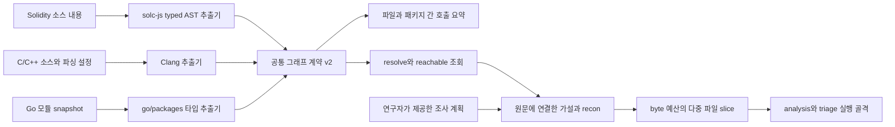

# 구조 평가와 구현 결정

검토일: 2026-10-11. 범위는 참고 글의 분석과 이 저장소의 harness 구현이다.
외부 대상에 대한 실제 보안감사는 이번 작업에 포함하지 않는다.

## 참고 글에서 확인한 구조

[Quarkslab 원문](https://blog.quarkslab.com/from-ai-agents-to-rce-building-a-vulnerability-research-workflow.html)은
재현 가능한 분석 코어와 비결정적인 agent 판단을 분리한다.
코어는 코드 관계와 taint·패턴 분석을 제공하고, agent는 가설을 조사하고 결과를 정리한다.
연구자는 단계 사이에서 방향과 증거를 확인한다.

원문의 단계는 `graph → recon → slicing → analysis → triage → poc → chain → exploit`이다.
전체 저장소를 한 번에 읽히기보다 좁은 범위를 조사하고, 관련 후보를 모은 뒤 동적으로 검증한다.
FreeRDP 사례에서 글에 다룬 두 slice의 후보 130개가 36개 cluster로 줄었고,
그중 20개가 재현되었다고 보고한다. 전체 보고까지는 4일이 걸렸다고 한다.
이 수치는 두 slice의 사례이며 전체 저장소의 정확도·재현율을 나타내지 않는다.
유효한 발견의 순위가 낮았고 최종 exploit 구성에는 연구자 개입이 필요했다고 명시한다.

## 효율적인 구조인가

**작업을 검토 가능한 단위로 나누는 구조는 타당하다. 성능 우위는 아직 검증되지 않았다.**
이는 원문의 설계를 검토한 판단이다. 공개 글은 내부 구현과 통제된 비교 실험을 제공하지 않으므로,
같은 모델을 사용한 단일 agent와의 비용·시간·품질 차이는 직접 측정해야 한다.

| 설계 요소 | 채택 이유 | 이 프로젝트에서 확인할 비용 또는 실패 가능성 |
| --- | --- | --- |
| 결정적인 코어와 agent 분리 | 증거 생산과 가설 판단의 책임을 명확히 함 | 코어의 잘못된 관계가 모든 후속 판단에 전파될 수 있음 |
| 좁은 slice | 입력 크기를 제한하고 개별 실험을 비교할 수 있음 | 호출자·객체 수명·다른 파일의 조건이 누락될 수 있음 |
| 넓게 찾고 triage로 줄임 | 연구자가 읽을 후보 수를 관리할 수 있음 | agent 비용이 오탐 수에 비례하므로 초기에 중복 제거 필요 |
| 별도 triage 세션 | 이전 대화에서 생긴 확신을 줄일 여지가 있음 | 같은 모델과 증거의 공통 오류는 독립 세션으로 해결되지 않음 |
| 동적 검증 | 관찰 가능한 결과를 확보함 | 직접 호출한 함수의 crash만으로 실제 노출 경로를 증명할 수 없음 |
| 단계별 기록과 연구자 점검 | 실패 지점과 판단 근거를 되짚기 쉬움 | 점검 빈도가 높으면 사람이 다시 병목이 됨 |

구현 순서는 **호출 구조 → 노출 정보 → 관계 기반 slice → 분석·triage**다.
처음 작성한 orchestration과 줄 slice는 이 핵심을 충족하지 못한 실행 골격이다.
현재는 Clang AST·Go 타입 정보·Solidity solc AST로 호출 그래프를 추출하고 공통 계약으로 초기 조사 단계에 제공한다.
Go에서는 선언 문맥·등록 사실을 더하고 연구자의 가설을 다중 파일 agent 입력으로 연결한다.
정규식이나 모델의 추측으로 호출 간선을 만들지 않는다.

## 현재 구현

현재 graph 단계는 실행 가능하다. 원문의 함수 포인터 해석·taint 및 전체 8단계를 복제한 완성품은 아니다.
`run --graph ... --recon ...`은 위 입력을 소비한다. 옵션 없는 실행은 기존 줄 입력을 유지한다.
recon은 원문 인용·함수 식별·등록 사실을 검증하나 자동 threat model 또는 taint 분석은 아니다.

| 원문 단계 | 현재 상태 | 다음 확장 위치 |
| --- | --- | --- |
| graph | 공통 계약, Clang/Go/Solidity 호출·도달 조회; Go 선언·인자, Solidity 상속·modifier 근거 | 미해결 관계 해석과 Python analyzer |
| recon | source에 연결한 연구자 가설·주석·컴포넌트·직접 HTTP 등록 | 자동 노출 탐색·위협 모델·우선순위의 근거 검증 |
| slicing | 한 가설의 다중 파일 함수·선언·호출 근거와 누락 기록; 기존 줄 입력 유지 | 실제 benchmark와 데이터 흐름 근거 기반 확장 |
| analysis | Codex 또는 replay, 고정 JSON 출력 | 결정적인 analyzer 결과를 증거로 첨부 |
| triage | 새 세션, 정확한 후보 ID 대응 | 확인된 root cause 기준 cluster와 반증 실험 |
| poc | 검증 계획과 대기열만 구현 | 별도 worker에서 regression 재현과 증거 수집 |
| chain | 미구현 | 검증된 결과 사이의 영향 관계 평가 |
| exploit | 미구현 | 기본 감사 보고 이후 별도 연구 범위로 결정 |

## 데이터와 상태

`graph.py`는 언어와 무관한 schema 검증·저장·요약·조회만 담당하고 `extractors/`가 언어별 추출을 맡는다.
`schemas/graph.json`이 공통 계약 v2다. 함수는 ID·언어·scope·종류·이름·시그니처·정의 위치,
호출은 caller/callee·호출 위치·status·dispatch·execution·reason·provenance를 갖는다.
컴파일러 고유 심볼·TU 목록은 metadata에 둔다. 파일/패키지 요약은 공통 코어가 확정된 호출로 계산한다.
새 결과는 v2를 쓰고 기존 v1 파일은 reader와 resolve/reachable에서 계속 읽는다.

C/C++ 함수의 경우:
함수 ID는 compiler 심볼과 정의 위치로 생성하며 `static`·anonymous namespace는 TU 범위를 포함한다.
같은 이름을 가진 파일 내부 함수와 C++ overload를 이름만으로 합치지 않는다.
같은 external 심볼에 서로 다른 정의가 있으면 `ambiguous`로 남긴다.
헤더의 동일 external inline 정의는 하나로 모으고 이를 파싱한 TU 목록을 보존한다.
공통 호출 상태는 `resolved`, `external`, `ambiguous`, `unresolved`다.
`dispatch`가 `indirect`, `virtual`, `constructor` 등의 해석 방식을 구분한다.
`resolved`에만 그래프 간선을 연결한다. `sizeof`와 `noexcept` 등 unevaluated 표현은 호출에서 제외한다.
암묵적인 호출과 모든 C++ 생명주기 동작을 포괄하는 그래프는 아니다.

`resolve`는 파일/함수/패키지의 정의·들어오는 호출·나가는 호출을 보여준다.
`reachable`은 직접 호출 간선으로만 탐색하며 도중의 미해결 호출도 반환한다.
이는 syntax상 호출 가능 범위이지 runtime 조건·공격자 노출·taint를 증명하는 결과가 아니다.

파싱은 [Clang AST](https://clang.llvm.org/docs/IntroductionToTheClangAST.html)를 사용하며,
설정 입력은 [Compilation Database](https://clang.llvm.org/docs/JSONCompilationDatabase.html) 형식을 지원한다.
DB의 프로그램을 실행하지 않고 `-I/-isystem/-iquote`, `-D/-U`, `-x`, `-std`만 전달한다.
버린 flag·DB에 없는 TU·parse 실패·미지원 언어·미방문 헤더를 coverage에 보존한다.
DB가 없으면 toolchain 기본 설정임을 표시하며, ignored flag가 있으면 coverage는 partial이다.
실패한 TU의 AST는 전부 제외한다. AST/로그는 각각 64 MiB, TU는 256개, 기본 timeout은 TU당 30초다.
대상 소스 변경을 전후 hash로 확인하고, 그래프 조회에서는 checksum과 간선 endpoint를 검사한다.
조회는 소스를 다시 열거나 실행하지 않는다. 입력 설정과 toolchain이 같으면 동일 JSON을 생성한다.

Go 추출기는 [go/packages](https://pkg.go.dev/golang.org/x/tools/go/packages)와
[go/types](https://pkg.go.dev/go/types)를 사용한다. 패키지 경로·receiver·generic 원형·정의 위치로
함수를 식별하고, import 별칭·다른 파일·패키지의 정적 함수와 구체 메서드를 연결한다.
인터페이스 호출과 함수 변수는 `callee=null`과 원인을 보존한다. points-to 분석을 추측으로 대체하지 않는다.
literal의 본문 호출은 별도 함수에 귀속하고 `go`/`defer` 실행 방식을 기록한다.
Go의 scope는 패키지 경로이며 `scope_calls`가 패키지 간 관계를 요약한다.

Go의 선택적 `contexts`는 타입/필드 선언, 전역 값 선언, 파일의 package/import 문맥을 담는다.
`context_ids`와 context의 `references`는 원문 의존성을 나타내며 호출 간선과 분리한다.
`resolve`/`reachable`는 참조 context의 위치도 반환하지만 소스를 다시 읽지는 않는다.
`function_arguments`는 인자로 전달된 직접 함수/literal ID 또는 미해결 원인을 보존한다.
v2의 선택적 확장이므로 이전 v2와 v1 조회는 유지한다. Clang에는 아직 선언 context 추출이 없다.

필터링된 소스와 go.mod/go.sum만 임시 복사해 분석하고 설정 hash를 재확인한다.
하나의 모듈과 호스트 기본 build 조건을 지원하며 workspace·중첩 모듈·로컬 replace는 거절한다.
사용자 환경의 driver/GOFLAGS를 제거하고 cgo·workspace·자동 toolchain 전환·다운로드를 차단한다.
타입 로딩에 필요한 export data는 컴파일할 수 있지만 대상 프로그램·init·test·generator는 실행하지 않는다.
외부 의존성은 전용 캐시에 사전 준비해야 한다. 실패 패키지의 부분 타입 정보로 관계를 생성하지 않는다.
package-global initializer와 reflection은 아직 모델링하지 않으며 이 제한을 graph에 기록한다.
기본 timeout은 helper build/analysis 각각 30초, 도구 출력/로그는 각각 64 MiB, 패키지는 256개까지다.

Solidity는 [Standard JSON](https://docs.soliditylang.org/en/v0.8.30/using-the-compiler.html)의
타입 검사가 끝난 AST를 사용한다. 소스 위치는 [byte source mapping](https://docs.soliditylang.org/en/v0.8.30/internals/source_mappings.html)을
실제 입력의 줄·byte column에 대응시킨다. 공통 v2 schema를 변경하지 않고 `contexts`와 metadata를 활용한다.
상속 header는 base context를 참조하며, 함수 metadata는 직접 base·C3 선형화·override ID를 보존한다.
비가상 내부/상속/library 함수와 modifier 적용만 resolved dependency로 연결한다.
modifier는 별도 함수 노드이며 적용 순서·placeholder 수와 본문 호출을 보존한다.
이 간선은 CFG가 아니며 modifier의 반복·함수 body 생략이나 authorization 효과를 증명하지 않는다.
외부 계약·interface·self-call·외부 library는 declaration ID를 남기되 `callee=null`로 처리한다.
virtual/super·함수 값·저수준 호출은 미해결이고 assembly는 opaque boundary다.

compiler는 pinned solc-js 0.8.30이며 npm 준비 단계만 다운로드한다. 실행 단계는 snapshot의
소스 내용만 넘기고 import callback의 filesystem/network fallback을 차단한다.
Node preload 환경변수와 대상 Foundry/Hardhat script를 사용하지 않는다. AST만 요청하며 EVM 코드는 실행하지 않는다.
256개 소스와 과정당 30초/출력 64 MiB 상한을 적용한다. compiler 오류가 있으면 batch의 모든 부분 AST를 제외한다.
프로젝트 remapping/build 설정, initializer 실행과 암묵적 base constructor는 아직 해석하지 않는다.

아래 계약은 별도로 구현된 기존 agent 실행 골격에 해당한다.

파일 내용 hash와 정렬된 경로가 source index를 식별한다.
기존 slice는 하나의 파일, 실제 시작·끝 줄, 원문, source hash를 가진다.
관계 기반 slice는 한 가설과 다중 파일 `fragments`, 실제 정의·호출 근거·조사 주석,
누락 수를 가진다. 각 fragment의 원문·줄·hash를 검증한다.
`recon.json`은 strict 연구 계획과 graph/source에서 재계산해 검증한다.
첫 버전의 보안 주석은 연구자가 제공한 가설이며, 자동 노출/위협 모델 분석이 아니다.
Go 표준 HTTP의 직접 함수 등록은 별도 근거다. 등록·호출·외부 노출은 구분한다.
분석 후보는 `path, line, CWE, title, reasoning, quote, validation_plan`을 반드시 제공한다.
schema 검증 외에 경로·줄·원문 인용을 확인한다. 모델이 만든 경로를 따라 추가 파일을 열지 않는다.

중복 제거는 `path + line + CWE`가 같은 occurrence에 한정한다.
관계 기반 입력은 가설 ID도 포함하여 같은 위치를 서로 다른 경로에서 조사한 결과를 구분한다.
이는 의미 기반 root cause clustering이 아니다. 서로 다른 원인이 같은 줄·CWE에 있으면 합쳐질 수 있으며,
원시 응답은 보존하므로 후속 구현에서 다시 분리할 수 있다.

triage 상태는 `needs_validation`, `uncertain`, `rejected`다.
현재 agent 계약에 `confirmed` 상태는 없다. 검증 대기열에는 앞의 두 상태가 남는다.
동적 재현, 실제 entry point의 도달 가능성, 배포 build 조건이 확보되기 전에는 확인된 취약점으로 승격하지 않는다.

완료된 단계만 cache에 저장한다. prompt/schema/내용 checksum을 확인하고,
source·provider/model·CLI 버전·prompt/schema·slice 설정이 달라지면 재개를 거절한다.
관계 기반 입력은 graph/recon identity와 실제 생성한 전체 slice 목록도 cache identity에 포함한다.
호출 횟수는 요청 전에 저장하므로 실패와 재개로 호출 한도가 초기화되지 않는다.
호출 한도와 timeout을 늘리는 것은 가능한 반면, 입력 범위를 바꾸려면 새 실행을 만든다.
외부 호출과 파일 저장을 하나의 transaction으로 묶을 수는 없으므로,
응답 이후 cache 저장 전에 프로세스가 중단되면 그 한 번은 재개 시 중복 호출될 수 있다.

## 실행 경계

개발 agent는 이 저장소를 수정한다. 감사 agent는 제공된 slice만 판단한다.
둘의 설정과 권한을 공유하지 않는다. Codex 연동은 임시 작업 디렉터리에서 시작하며,
사용자 설정·대상 AGENTS·shell·apps·plugins·hooks·browser·추가 agent를 제한한다.
사용하는 옵션은 [Codex 실행 문서](https://learn.chatgpt.com/docs/developer-commands#codex-exec)와
[설정 참고](https://learn.chatgpt.com/docs/config-file/config-reference)를 기준으로 확인했다.
모델 호출 전 로컬 `features list`에서 필요한 도구 제한이 실제로 꺼졌는지 확인하고,
확인할 수 없거나 활성 상태라면 호출을 거절한다. 설치된 CLI 0.155.0은 `unified_exec=false`를
지정해도 활성 상태를 표시했으므로 해당 backend 설정을 보안 제한으로 사용하지 않는다.
shell 도구 차단과 sandbox 설정을 사용하며, 이 사전 확인만으로 runtime 도구 격리를 증명하지는 않는다.
관리자가 적용한 설정은 이 코드가 제거하지 못하며, 실제 모델 연동은 별도 실환경 검증이 필요하다.

소스의 주석과 문자열, 모델 응답은 지시가 아닌 자료로 취급한다.
도구를 제한해도 prompt injection으로 판단이 왜곡될 가능성은 남는다.
schema와 인용 검증은 위치와 형식을 보장할 뿐 취약점 주장 자체를 증명하지 않는다.

현재 loader는 hidden 디렉터리, 지정된 생성물·vendor 디렉터리, symlink, 지원하지 않는 확장자,
binary, non-UTF-8, 512 KiB 초과 파일을 제외한다. 읽은 소스는 최대 32 MiB,
탐색 파일은 최대 20,000개다. slice보다 긴 한 줄이 있으면 그 파일의 분할을 제외한다.
제외 내역과 lexical 순서에서 한도 때문에 남은 slice를 coverage에 기록한다.
줄 묶음은 의미 경계·호출 관계를 보장하지 않으며, `.gitignore`와 소스 내부 비밀정보는 자동 처리하지 않는다.
source 디렉터리는 인덱싱 중 안정적으로 유지해야 한다. 적대적인 동시 변경에 대한 snapshot 격리는 후속 작업이다.

동적 검증은 호스트에서 실행하지 않는다. 다음 worker의 최소 조건은 폐기 가능한 container/VM,
읽기 전용 입력, 분리된 scratch, 기본 외부 네트워크 차단, credential 미주입, CPU·memory·시간 한도,
명시적인 build recipe다. 원문의 sanitizer와 배포 설정 문제는 이 경계의 build matrix로 다룬다.
container를 쓴다는 이유만으로 완전한 격리를 주장하지 않는다.

## 효율성 측정 계획

실제 성능 평가는 같은 source snapshot과 정답 집합으로 수행한다.
취약 예제, 수정된 예제, 정상 경계 사례를 함께 넣고 분석할 범위를 고정한다.
replay는 파이프라인의 결정성과 실패 처리를 검사하며 LLM의 탐지 품질을 평가하지 않는다.

| 비교 | 고정할 조건 | 볼 지표 |
| --- | --- | --- |
| 한 세션과 분리된 analysis/triage | 모델, source, 최대 호출·입력 예산 | 검증된 발견, 정상 코드 오탐, 총 token, 시간 |
| 줄 slice와 관계 기반 slice | 정답, 대상 snapshot, 분석 예산 | 누락한 원인, 필요했던 추가 context |
| triage 전후 | 동일 후보 집합 | 제거된 오탐, 잘못 버린 참양성, 검토할 후보 수 |
| 신규 실행과 checkpoint 재개 | 동일 계약과 source | 추가 호출, cache hit, 복구 시간 |

`metrics.json`은 호출 시도, cache hit, 후보·verdict 수, provider가 보고한 token을 기록한다.
알 수 없는 token 사용량은 0으로 꾸미지 않는다. 실패한 호출의 token은 원시 이벤트를 추가로 확인해야 하며,
현재 집계는 유효한 응답에 보고된 사용량만 포함한다. latency·가격·연구자 검토 시간의
일반적인 성능 결론은 실모델 benchmark 이후에 낸다.
